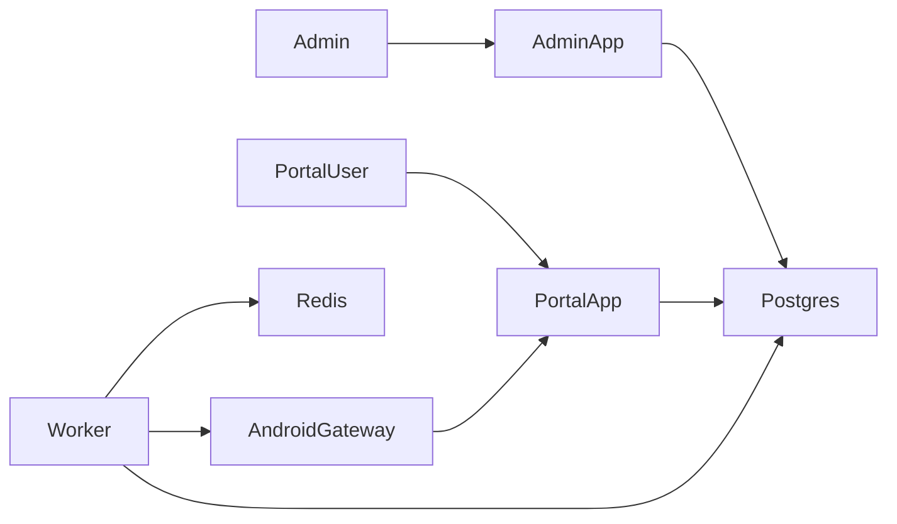

# Workflow

M0 does not serve this path. The diagram is the runtime from GChoPro-PRD.md §1 and §13, which later milestones implement. Node ids have no spaces.

The admin pairs a device and binds a SIM. The user sends from the portal. The worker paces dispatch. The phone polls, sends through the SIM, and reports status. A suspected suspension pauses that SIM and alerts the admin. Recovery is a manual re-test.
